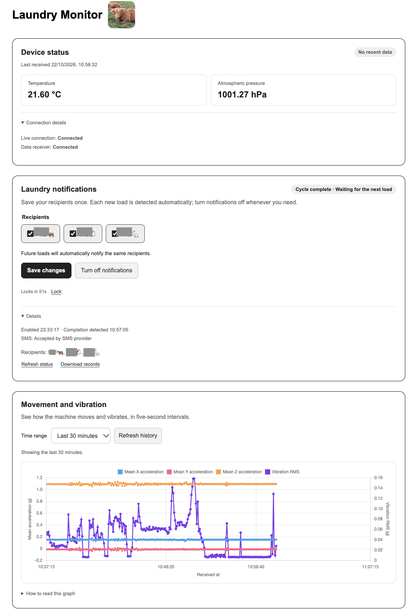
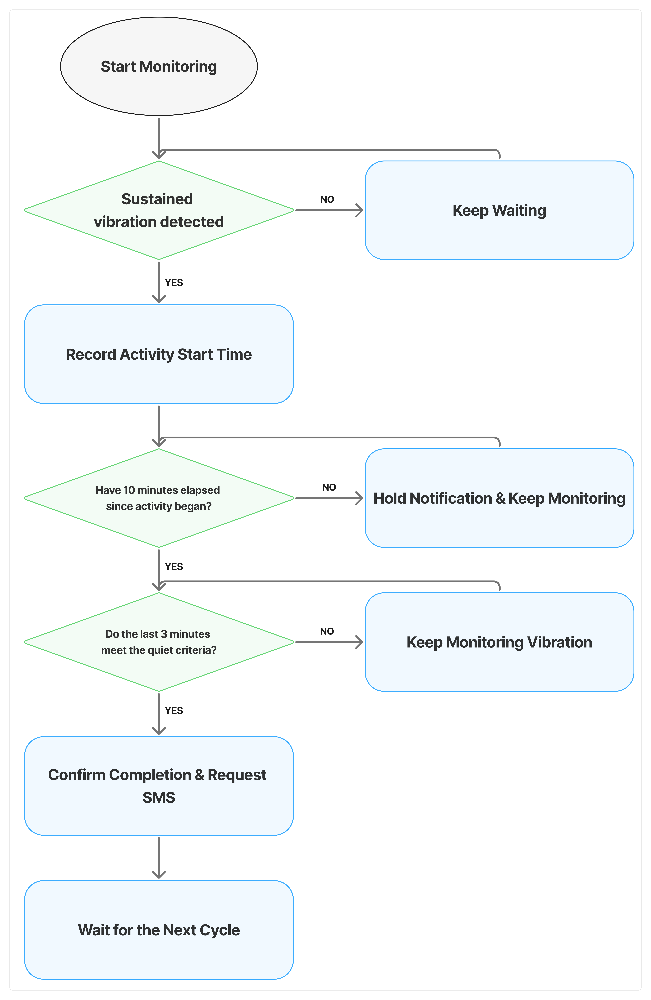

# Laundry Monitor

**Laundry completion notifications with ESP32 and Azure · ESP32와 Azure 기반 세탁 완료 알림**

[English](#english) · [한국어](#korean)

## English

I built a laundry monitoring and notification system for my flatmates and me to use, so we wouldn't have to keep checking whether the laundry had finished. An ESP32 measures the washing machine's vibration, and Azure Functions detects when a washing or drying cycle is complete and triggers an SMS notification.

### What it does

- Shows live vibration, temperature and pressure readings, with recent history on a web dashboard.
- Sends completion notifications through TextBee and an Android phone's SIM, even when the dashboard is closed.
- Lets household members select recipients behind a shared password (PIN), keep their preferences for the next load, or turn notifications off.
- Provides English and Korean interfaces.

View the dashboard / 대시보드 보기

### System architecture

The ESP32 samples acceleration at 50 Hz and sends batches of approximately five seconds to Azure IoT Hub over MQTT. IoT Hub routes the data to the web app, Azure Functions and a raw-data archive.

Azure Functions stores summaries of sensor data batches and detects cycle completion. The web dashboard and completion-detection Function share notification settings and cycle records in Table Storage, allowing the Function to run independently of the web app. Blob Storage preserves the raw sensor readings as AVRO files.

### How completion is detected

The detector uses vibration RMS and timing rules. It first confirms sustained activity, waits until at least ten minutes have passed since activity began, then checks whether the latest three minutes meet the quiet criteria. Missing data does not count as a quiet machine. New activity starts the next cycle with the saved recipients.

View the completion-detection flow / 완료 감지 흐름도 보기

### Implementation highlights

- **Device connectivity:** Wi-Fi and MQTT reconnection, fresh SAS authentication after startup, and automatic token renewal.
- **Independent cloud processing:** separate consumers for history storage, completion detection and the live dashboard.
- **Persistent notification state:** shared Table Storage records with ETag checks to prevent concurrent changes from overwriting one another.
- **Duplicate-send prevention:** recording a send attempt before calling the SMS provider, with handling for restarts, repeated events and uncertain responses.
- **Live and historical views:** Server-Sent Events for incoming readings and Table queries to restore recent charts.

### Technology stack

| Area | Technologies |
|---|---|
| Hardware | ESP32, MPU6050, BMP280, I²C |
| Firmware | C, ESP-IDF, FreeRTOS, ESP-MQTT, mbedTLS |
| Cloud | Azure IoT Hub, Functions, App Service, Blob Storage, Table Storage |
| Web | Python, Flask, Gunicorn, JavaScript, SSE, Chart.js |
| Notifications | TextBee, Android SMS gateway |

### Validation and limitations

Detection is based on vibration patterns rather than identifying the washing programme. In use, I found that long pauses within a programme and sensor placement can affect completion detection. Recording a send attempt helps avoid duplicate requests, but an interruption immediately afterwards can leave a message unsent. Provider acceptance also does not confirm delivery to the recipient's phone.

This repository contains the web app and shared detection and notification code. The [ESP32 firmware](https://github.com/hwahyeon-park/laundry-esp) is documented separately.

---

## 한국어

세탁이 끝났는지 매번 확인하러 가는 불편함을 줄이기 위해, 룸메이트들과 함께 사용할 세탁 모니터링·알림 시스템을 만들었습니다. ESP32로 세탁기 진동을 측정하고, Azure Functions에서 세탁·건조 완료를 판단하여 문자로 알려줍니다.

### 주요 기능

- 실시간 진동·온도·기압과 최근 기록을 보여주는 웹 대시보드
- 웹페이지를 닫아도 TextBee와 Android 휴대폰의 SIM을 통해 전송되는 완료 알림 문자
- 공통 비밀번호(PIN)로 보호되는 수신자 선택, 다음 세탁에도 유지되는 설정, 알림 끄기
- 한국어·영어 화면 지원

대시보드 화면은 위의 **대시보드 보기**에서 확인할 수 있습니다.

### 시스템 구조

[위 시스템 구조도](#system-architecture)처럼 ESP32가 가속도를 50 Hz로 수집하고 약 5초 단위로 묶어 MQTT로 Azure IoT Hub에 전송합니다. IoT Hub는 데이터를 웹 앱, Azure Functions, 원본 데이터 저장소로 전달합니다.

Azure Function이 센서 데이터 묶음의 요약을 저장하고 완료를 감지합니다. 웹 대시보드와 완료를 감지하는 Function은 Table Storage에서 알림 설정과 사이클 기록을 공유하므로, 웹 앱과 독립적으로 실행됩니다. Blob Storage에는 원본 센서 데이터를 AVRO 파일로 보관합니다.

### 완료 감지 방식

진동 RMS와 시간 조건으로 완료를 판단합니다. 먼저 지속적인 진동으로 동작 시작을 확인한 뒤, 시작 후 최소 10분이 지났는지와 최근 3분이 정지 조건을 만족하는지 확인합니다. 통신이 끊겨 데이터가 없는 시간을 정지 상태로 계산하지 않으며, 새로운 동작이 확인되면 기존 수신자 설정으로 다음 사이클을 감지합니다.

자세한 흐름은 위 [완료 감지 도식](#how-completion-is-detected)에서 볼 수 있습니다.

### 구현에서 집중한 부분

- **장치 연결:** Wi-Fi·MQTT 재연결, 부팅 후 새로운 SAS 인증 정보 생성, 토큰 자동 갱신
- **독립적인 클라우드 처리:** 기록 저장·완료 감지·실시간 웹 대시보드를 위한 별도 데이터 수신 처리
- **지속적인 알림 상태 저장:** Table Storage에서 상태를 공유하고, ETag 검사로 동시 변경이 서로 덮어쓰는 것을 방지
- **중복 발송 방지:** SMS 제공자 호출 전에 발송 시도를 기록하고, 재시작·중복 이벤트·불확실한 응답에 대응
- **실시간·과거 데이터 조회:** SSE로 수신 데이터를 전달하고, Table 조회로 최근 그래프를 복원

### 기술 스택

| 구분 | 사용 기술 |
|---|---|
| 하드웨어 | ESP32, MPU6050, BMP280, I²C |
| 펌웨어 | C, ESP-IDF, FreeRTOS, ESP-MQTT, mbedTLS |
| 클라우드 | Azure IoT Hub, Functions, App Service, Blob Storage, Table Storage |
| 웹 | Python, Flask, Gunicorn, JavaScript, SSE, Chart.js |
| 알림 | TextBee, Android SMS 게이트웨이 |

### 검증과 한계

세탁 코스 자체를 인식하는 대신 진동 패턴으로 판단합니다. 실제 사용 과정에서 코스에 따른 긴 일시정지나 센서 위치가 완료 감지에 영향을 주는 것을 확인했습니다. 발송 시도를 먼저 기록하면 중복 요청을 줄일 수 있지만, 기록 직후 서버가 중단되면 문자가 누락될 수 있습니다. SMS 제공자가 요청을 접수했다는 응답도 수신 휴대폰에 실제로 도착했다는 뜻은 아닙니다.

이 저장소는 웹 앱과 공통 감지·알림 코드를 담고 있습니다. [ESP32 펌웨어](https://github.com/hwahyeon-park/laundry-esp)는 별도로 정리했습니다.
